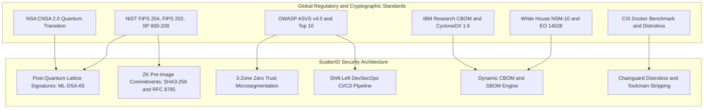
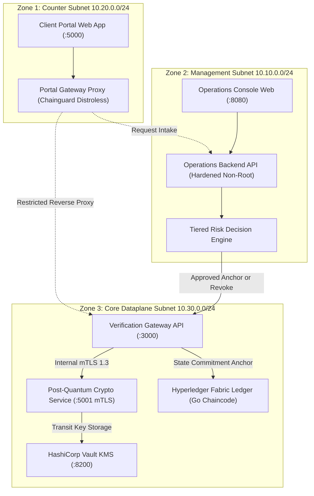
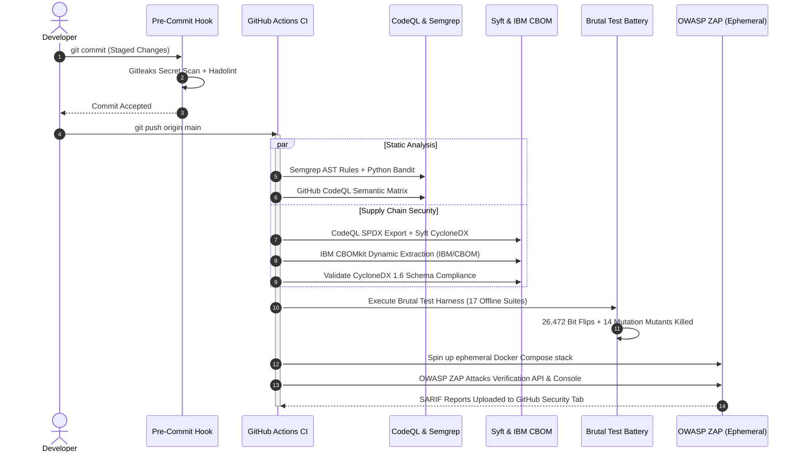

# ScatterID — Post-Quantum Zero-Knowledge Identity Verification Infrastructure

<div align="center">

[](https://www.scatterid.tech/)
[](https://www.linkedin.com/in/0x4rc4n3)
[](.github/workflows/devsecops.yml)
[](https://csrc.nist.gov/pubs/fips/204/final)
[-purple.svg?style=for-the-badge)](https://github.com/IBM/CBOM.git)
[](components/client-portal/server/Dockerfile)
[](LICENSE)

<br/>

**Enterprise-Grade Post-Quantum Zero-Knowledge Digital Identity Framework**  
*Formally verified against NIST FIPS 204, NSA CNSA 2.0, OWASP ASVS v4.0, and White House NSM-10 directives.*

</div>

---

## 1. Executive Summary & Problem Statement

Modern Public Key Infrastructure (PKI)—including RSA, ECDSA, and Ed25519—is mathematically vulnerable to Shor’s algorithm running on cryptanalytically relevant quantum computers (CRQCs). Adversaries are already executing **"Harvest Now, Decrypt Later" (HNDL)** attacks against enterprise digital credentials and government identity dataplanes.

**ScatterID** is an open-architecture, privacy-preserving, decentralized identity verification infrastructure engineered for the post-quantum era. By synthesizing **NIST FIPS 204 ML-DSA-65 post-quantum lattice signatures**, **RFC 8785 JSON Canonicalization (JCS)**, **FIPS 202 SHA3-256 Zero-Knowledge commitments**, and **Hyperledger Fabric permissioned ledger immutability**, ScatterID ensures digital credentials cannot be forged, manipulated, or reverse-engineered—even by quantum adversaries.

### Core Architectural Invariants:
1. **Zero-Knowledge Data Minimization**: Relying parties and verification gateways NEVER observe user Personally Identifiable Information (PII). Claims are canonicalized and salted on the client device; only a 32-byte cryptographic commitment ($H(\text{salt} \mathbin{\Vert} \text{claim})$) is transmitted.
2. **Post-Quantum Cryptographic Agility**: Signatures are generated using NIST FIPS 204 ML-DSA-65 (192-bit classical security, Quantum Category 3), with automated migration paths cataloged via dynamic Cryptography Bill of Materials (CBOM).
3. **Air-Gapped Standalone Verification**: Credentials can be mathematically verified offline without network connectivity, internet access, or blockchain node availability.
4. **Shift-Left DevSecOps & Container Hardening**: Every commit is verified through an 8-stage automated DevSecOps pipeline featuring Gitleaks, Semgrep, CodeQL, dynamic SBOM/CBOM generation, Chainguard distroless runtimes, and a brutal 17-suite test battery.

---

## 2. Enterprise Security Implementations & Regulatory Standards Mapping

ScatterID's security controls are systematically mapped to authoritative national and international security standards:



### Authoritative Standards Compliance Matrix

| Organization / Authority | Standard / Directive | ScatterID Component & Implementation | Invariant Enforced / Security Property |
| :--- | :--- | :--- | :--- |
| **NIST (National Institute of Standards and Technology)** | **NIST FIPS 204**<br/>*(Module-Lattice Digital Signatures)* | `components/crypto/crypto-service/pq_sign.py`<br/>via `liboqs` bindings | Enforces **ML-DSA-65** lattice signatures (3,309-byte sig, 1,952-byte PK). Resilient against classical and quantum poly-logarithmic sieve attacks (Quantum Category 3). |
| **NIST** | **NIST FIPS 202**<br/>*(SHA-3 Standard)* | `sdk/src/crypto.ts`<br/>`components/client-portal/frontend` | Enforces **SHA3-256** (Keccak permutation) for claimant pre-image commitments, guaranteeing second pre-image and collision resistance. |
| **NIST** | **NIST SP 800-38D**<br/>*(Block Cipher Modes: GCM)* | `tools/verify_offline.js`<br/>`components/ops-dashboard` | Enforces **AES-256-GCM** with 96-bit random IVs and 128-bit authentication tags for encrypted key backup envelopes and state snapshots. |
| **NIST** | **NIST SP 800-63B**<br/>*(Digital Identity Guidelines)* | `components/ops-dashboard/src/auth`<br/>`components/verification-api` | Implements **Argon2id** memory-hard password hashing ($m=64\text{MB}, t=3, p=4$) and peppered **HMAC-SHA256** recovery codes. |
| **IETF** | **RFC 8785 (JCS)**<br/>*(JSON Canonicalization)* | `sdk/src/canonicalize.ts`<br/>`tools/verify_offline.py` | Deterministic key sorting and normalization; guarantees identical cryptographic hashes across V8, browser, and Python runtimes. |
| **NSA (National Security Agency)** | **NSA CNSA 2.0**<br/>*(Commercial National Security Suite)* | Master Cryptographic Layer | Conforms to NSA's mandate transitioning national security identity infrastructure to post-quantum signature schemes (ML-DSA). |
| **Executive Office of the President** | **White House NSM-10 & EO 14028**<br/>*(Quantum Migration & Supply Chain)* | `tools/generate_cbom.py`<br/>`.github/workflows/devsecops.yml` | Dynamic, automated generation of machine-readable **SBOM** (SPDX 2.3) and **CBOM** (CycloneDX 1.6) on every build without hardcoded data. |
| **IBM Research / PQCA** | **[IBM/CBOM](https://github.com/IBM/CBOM.git)**<br/>*(Cryptography Bill of Materials)* | `tools/generate_cbom.py`<br/>`tests/test_cbom_compliance.py` | CycloneDX 1.6 Cryptographic BOM capturing algorithm properties, classical/quantum bit levels, OIDs, and X.509 RSA/TLS 1.3 parameters. |
| **OWASP Foundation** | **OWASP ASVS v4.0**<br/>*(App Security Verification Level 3)* | Entire Microservices Stack | Enforces timing-safe comparisons (`crypto.timingSafeEqual`), parameterized SQL, session revocation tracking, and CSP/HSTS headers. |
| **Center for Internet Security (CIS)** | **CIS Docker Benchmark v1.6** | Multi-Stage Dockerfiles & Chainguard Images | Non-root execution (`uid 65532` / `nodeapp`), distroless base images (zero CVEs, no shell, no package manager), and toolchain stripping. |

---

## 3. High-Level System Architecture & Zero Trust Microsegmentation

ScatterID divides the enterprise network into **three microsegmented security zones** via Docker Compose and kernel-level network bridging:



### Network Zone Isolation Rules:
* **Zone 1 (Counter Subnet `10.20.0.0/24`)**: Public-facing counter desks running the Client Portal. Strictly prohibited from accessing Zone 3 directly. All verification queries are proxied via sanitizing gateways.
* **Zone 2 (Management Subnet `10.10.0.0/24`)**: Restricted administrative subnet for identity operators and moderators. Governed by multi-tiered approval workflows.
* **Zone 3 (Core Dataplane `10.30.0.0/24`)**: Isolated high-security enclave housing cryptographic signing keys, Vault KMS, and the Hyperledger Fabric blockchain ledger. Mutual TLS (TLS 1.3) with dedicated internal certificates is enforced across all endpoints.

---

## 4. End-to-End Shift-Left DevSecOps CI/CD Pipeline

ScatterID implements an enterprise **Shift-Left DevSecOps pipeline** ([`.github/workflows/devsecops.yml`](.github/workflows/devsecops.yml)) where security is integrated continuously into developer workflows:



### The 8 DevSecOps Pipeline Phases:

1. **Shift-Left Secret Scanning (Gitleaks)**:
   - Scans commits and history with zero false-positives using custom ScatterID entropy patterns ([`.gitleaks.toml`](.gitleaks.toml)).
   - Specifically protects `VERIFICATION_API_KEY`, `CRYPTO_SERVICE_API_KEY`, `REVOKE_API_KEY`, and recovery peppers.
2. **Static Application Security Testing (SAST - Semgrep & Bandit)**:
   - **Semgrep OSS** ([`.semgrep.yml`](.semgrep.yml)): Enforces OWASP Top 10, CWE-338 (banning `Math.random()`), CWE-89 (parameterized SQL), and CWE-208 (timing-safe comparisons).
   - **Bandit**: Analyzes Python crypto-service ASTs for shell injections, insecure deserialization, and socket binding errors.
3. **Deep Semantic Analysis (GitHub CodeQL Matrix)**:
   - Compiles repository code into relational AST databases to perform inter-procedural taint-tracking across `javascript-typescript` and `python`.
4. **Container & Infrastructure-as-Code (IaC) Security**:
   - **Hadolint**: Lints Dockerfiles against CIS container standards.
   - **Checkov**: Validates Docker Compose network isolation and bridge configurations.
5. **Software Composition Analysis (SCA & Trivy)**:
   - Scans filesystems, lockfiles, and images for known vulnerabilities in the National Vulnerability Database (NVD).
6. **Dynamic Software Bill of Materials (SBOM)**:
   - Exports dynamic SPDX 2.3 manifests via GitHub CodeQL / Dependency Graph API.
   - Anchore Syft produces dynamic CycloneDX 1.6 and SPDX JSON manifests with zero hardcoding.
7. **Dynamic Cryptography Bill of Materials (CBOM - IBM Standard)**:
   - [`tools/generate_cbom.py`](tools/generate_cbom.py) dynamically parses code ASTs and cert generation parameters into a CycloneDX 1.6 Cryptographic BOM per [IBM/CBOM](https://github.com/IBM/CBOM.git).
   - Runs `ghcr.io/cbomkit/cbomkit-theia:latest` and validates assertions via [`tests/test_cbom_compliance.py`](tests/test_cbom_compliance.py).
8. **Dynamic Application Security Testing (DAST - OWASP ZAP)**:
   - Boots ephemeral containers in isolated subnets, verifies health probes, and performs dynamic attacks against active HTTP APIs.

---

## 5. Container Hardening Architecture: Chainguard Distroless

ScatterID enforces container attack surface minimization by categorizing workloads into distinct hardening tiers:

```
┌─────────────────────────────────────────────────────────────────────────────────┐
│                           Container Hardening Matrix                            │
├───────────────────────────────┬─────────────────────────────────────────────────┤
│ Workload Type                 │ Container Strategy & Base Image                 │
├───────────────────────────────┼─────────────────────────────────────────────────┤
│ Pure JS/TS Gateway Proxy      │ Chainguard Distroless (cgr.dev/chainguard/node) │
│ (Client Portal Server)        │ - 0 Known CVEs                                  │
│                               │ - No shell (/bin/sh, /bin/bash)                 │
│                               │ - No package manager (apk/apt)                  │
│                               │ - Non-root default execution (UID 65532)        │
├───────────────────────────────┼─────────────────────────────────────────────────┤
│ Native C++ Addon Microservice │ Multi-Stage Build Toolchain Stripping           │
│ (better-sqlite3, argon2)      │ - Builder: node:20-slim compiles native addons  │
│                               │ - Runtime: Copies compiled bindings only        │
│                               │ - Strips gcc, g++, make, python3 from prod      │
│                               │ - Dedicated unprivileged user (nodeapp:1001)    │
├───────────────────────────────┼─────────────────────────────────────────────────┤
│ Post-Quantum Crypto Service   │ Multi-Stage Python Runtime                      │
│ (liboqs C-Library Signing)    │ - Builds liboqs shared C-libraries in build     │
│                               │ - Runs as non-root cryptoapp user (UID 1001)    │
│                               │ - Read-only certificate volume mounts           │
└───────────────────────────────┴─────────────────────────────────────────────────┘
```

---

## 6. The Brutal Testing Battery ("Test Brutally From Top to Bottom")

ScatterID’s verification strategy validates invariants at every layer of the cryptographic and operational stack:

```
                  ┌──────────────────────┐
                  │ Chaos & Resilience   │  Vault timeouts, Slowloris, TCP reset
               ┌──┴──────────────────────┴──┐
               │ Authorization Mutation     │  14 mutants injected into chaincode & API
            ┌──┴────────────────────────────┴──┐
            │ Tamper Sensitivity Verification  │  26,472 bit flips exhaustively rejected
         ┌──┴──────────────────────────────────┴──┐
         │ Generative Fuzzing & Parity (5k iters) │  RFC 8785 canonicalization cross-engine
      ┌──┴────────────────────────────────────────┴──┐
      │ Boundary & NIST CAVP Math Verification       │  Salt boundaries, off-by-one, RFC tests
   ┌──┴──────────────────────────────────────────────┴──┐
   │ Comprehensive Unit & Functional Suites (17 Suites) │  SDK, Verification API, Ops Dashboard, etc.
   └────────────────────────────────────────────────────┘
```

### Brutal Test Suite Highlights:
* **Exhaustive Tamper Sensitivity ([`tests/test_tamper_sensitivity.py`](tests/test_tamper_sensitivity.py))**:
  Flips every single bit across a 32-byte SHA3-256 hash (256 tests) and all 26,472 bits in a NIST ML-DSA-65 signature. **Invariant: 100% of bit flips are mathematically rejected.**
* **Authorization Mutation Testing ([`tests/mutation_auth.test.sh`](tests/mutation_auth.test.sh))**:
  Injects 14 distinct code mutations (inverting MSP checks, bypassing signature verification, tampering with status transitions). **Invariant: 100% of mutants killed.**
* **RFC 8785 Generative Parity Fuzzer ([`tests/fuzz_canonicalize_parity.py`](tests/fuzz_canonicalize_parity.py))**:
  Executes 5,000 randomized JSON fuzzing rounds containing Unicode surrogate pairs, exponential floats, and nested objects to verify cross-runtime serialization invariance between Node.js and Python.
* **Hyperledger Fabric Chaincode Concurrency Fuzzing**:
  Runs Go coverage-guided fuzzers (`go test -fuzz=FuzzAnchorProof` and `FuzzRevokeProof`) verifying ledger invariants against race conditions.

---

## 7. Clean Directory Tree Structure

```
ScatterID/
├── .github/
│   └── workflows/
│       ├── ci.yml                     # Continuous integration test runner
│       ├── devsecops.yml              # 8-stage Shift-Left DevSecOps master pipeline
│       └── codeql.yml                 # Semantic code analysis workflow
├── .gitleaks.toml                     # High-entropy secret scanner configuration
├── .pre-commit-config.yaml            # Workstation git hook configurations
├── .semgrep.yml                       # Custom AST security rules (OWASP/CWE)
├── .zap/
│   └── rules.tsv                      # OWASP ZAP dynamic application scan rules
├── components/
│   ├── blockchain/
│   │   ├── chaincode/                 # Go Fabric smart contracts (MockStub & fuzz tests)
│   │   └── fabric-network/            # Raft consensus peer & orderer configs
│   ├── client-portal/
│   │   ├── frontend/                  # React client counter application (CASL RBAC)
│   │   └── server/                    # Gateway proxy (Chainguard Distroless Dockerfile)
│   ├── crypto/
│   │   ├── certs/                     # X.509 RSA-4096 mTLS generation scripts
│   │   ├── crypto-service/            # NIST FIPS 204 ML-DSA-65 signer (Python/liboqs)
│   │   └── liboqs/                    # Open Quantum Safe C-library reference
│   ├── ops-dashboard/                 # Operations Console Backend (:8080 / Express / SQLite)
│   ├── ops-dashboard-web/             # Executive Web Console (React-Admin / RBAC)
│   └── verification-api/              # Verification Gateway API (:3000 / Multi-Stage Dockerfile)
├── docs/
│   ├── DEVSECOPS_GUIDE.md             # Authoritative DevSecOps & architecture guide
│   ├── architecture-overview.md       # Interactive Mermaid architectural flowcharts
│   └── ...                            # Full technical specifications index
├── packages/
│   └── design-tokens/                 # Shared UI tokens and theme definitions
├── scripts/
│   ├── quickstart.sh                  # Turnkey single-command stack launcher
│   ├── start.sh                       # Service bootstrapper
│   ├── network/                       # iptables network microsegmentation scripts
│   └── security/
│       ├── devsecops_audit.sh         # Local automated 6-phase DevSecOps audit runner
│       └── audit_service_keys.sh      # Service key entropy & hygiene auditor
├── sdk/                               # TypeScript SDK (@scatterid/sdk / RFC 8785 + SHA3-256)
├── tests/
│   ├── run_all_unit_tests.sh          # Unified test harness (17 offline test suites)
│   ├── test_cbom_compliance.py        # CycloneDX 1.6 Cryptographic BOM validator
│   ├── test_tamper_sensitivity.py     # 26,472 bit-flip signature sensitivity harness
│   ├── mutation_auth.test.sh          # 14-mutant authorization mutation testing framework
│   └── fuzz_canonicalize_parity.py    # 5,000 iteration RFC 8785 cross-runtime fuzzer
├── tools/
│   ├── generate_cbom.py               # Dynamic IBM CBOM extraction engine (Zero-Hardcoding)
│   ├── verify_offline.js              # Standalone Node.js offline verifier (Level 1)
│   └── verify_offline.py              # Standalone Python offline verifier (Level 1 & Level 2)
├── docker-compose.yml                 # 3-Zone microsegmented topology definition
├── .env.example                       # Authoritative configuration template
├── LICENSE                            # PolyForm Noncommercial License 1.0.0
└── README.md                          # Master Project Overview
```

---

## 8. Quickstart & Local DevSecOps Execution

### 8.1 Execute the Complete DevSecOps Battery Locally
Developers can run the complete 6-phase security audit battery on their workstation before pushing code:

```bash
# Execute Secrets, SAST, SBOM, CBOM, SCA, and the Brutal 17-Suite Test Harness
bash scripts/security/devsecops_audit.sh
```

### 8.2 Launch Turnkey Microservices Topology
```bash
# Provision certificates, keys, SQLite databases, and boot all microservices
./scripts/quickstart.sh
```

### Local Service Endpoints:
| Service | Endpoint | Network Zone | Runtime Environment |
| :--- | :--- | :--- | :--- |
| **Operations Console** | `http://localhost:8080` | Zone 2 (`10.10.0.10`) | Hardened Node.js (Appsmith / non-root) |
| **Client Portal Gateway** | `http://localhost:5000` | Zone 1 (`10.20.0.10`) | **Chainguard Distroless** (Node.js / UID 65532) |
| **Verification API** | `http://localhost:3000` | Zone 3 (`10.30.0.11`) | Hardened Node.js (Multi-stage non-root) |
| **PQC Crypto Service** | `https://localhost:5001` | Zone 3 (`10.30.0.10`) | Python 3.13 / liboqs (Internal mTLS 1.3) |
| **HashiCorp Vault KMS** | `http://localhost:8200` | Zone 3 (`10.30.0.20`) | HashiCorp Vault (Transit Secrets Engine) |

---

## 9. Standalone Offline Verification

Auditors and relying parties can mathematically validate any issued credential **100% offline** without network connectivity or blockchain dependencies:

```bash
# 1. Zero-Dependency Node.js Verifier (Level 1)
# Validates RFC 8785 canonicalization, salting, SHA3-256 pre-image commitment,
# and verifies container structural dimensions (3,309B signature / 1,952B public key).
node tools/verify_offline.js <path-to-credential.json> [--public-key <hex>]

# 2. Cryptographic Python Verifier (Level 1 & Level 2)
# Executes complete Level 2 ML-DSA-65 post-quantum signature verification
# against the issuer's public key using liboqs.
python3 tools/verify_offline.py <path-to-credential.json> [--public-key <hex>]
```

---

## 10. Threat Model & Invariant Enforcements

ScatterID is engineered with defense-in-depth against key attack vectors:

| Threat Vector | Potential Impact | ScatterID Mitigation & Invariant Enforced |
| :--- | :--- | :--- |
| **Quantum "Harvest Now, Decrypt Later"** | Future CRQC reverses digital signatures | Enforces NIST FIPS 204 ML-DSA-65 post-quantum lattice signatures; audited via dynamic CycloneDX 1.6 CBOM. |
| **PII Data Leakage via Gateway Logs** | Breach of citizen privacy | TypeScript SDK hashes claims locally; only 32-byte salted SHA3-256 commitments cross network boundaries. |
| **Canonicalization Mismatch Attack** | Verifiers falsely reject or accept mutated JSON | Enforces RFC 8785 JCS determinism; verified by 5,000-iteration generative cross-engine fuzzers. |
| **Container Escape / Privilege Escalation** | Attacker compromises container host | Client Portal runs on **Chainguard Distroless** (no shell, no package manager, non-root UID 65532); compilers stripped from production. |
| **Lateral Subnet Pivoting** | Compromised portal compromises KMS | 3-Zone microsegmentation blocks Zone 1 from communicating with Zone 3 dataplane. |
| **Timing Side-Channel Analysis (CWE-208)** | Key/secret reconstruction via timing deltas | Constant-time comparisons (`crypto.timingSafeEqual`) enforced across all secret and HMAC validations. |
| **Stale Session Token Replay** | Attacker uses token after password reset | Active `token_version` embedded in JWT; password reset or device transfer immediately revokes all prior tokens. |

---

## 11. About the Creator

ScatterID is designed and engineered by **Mudassir Javed** (`0x4rc4n3`), a cybersecurity graduate specializing in security architecture, applied post-quantum cryptography, and DevSecOps engineering.

* **Website:** [scatterid.tech](https://www.scatterid.tech/)
* **LinkedIn:** [linkedin.com/in/0x4rc4n3](https://www.linkedin.com/in/0x4rc4n3)
* **GitHub:** [github.com/0x4rc4n3](https://github.com/0x4rc4n3)
* **Email:** [mudassirbhatti276@gmail.com](mailto:mudassirbhatti276@gmail.com)

---

## 12. Security Disclosures

Please consult [`SECURITY.md`](SECURITY.md) for our responsible disclosure process and vulnerability response commitments.

---

## 13. License

ScatterID is released under the **PolyForm Noncommercial License 1.0.0**. See [`LICENSE`](LICENSE) for complete terms.
