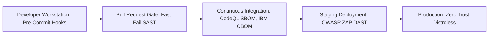
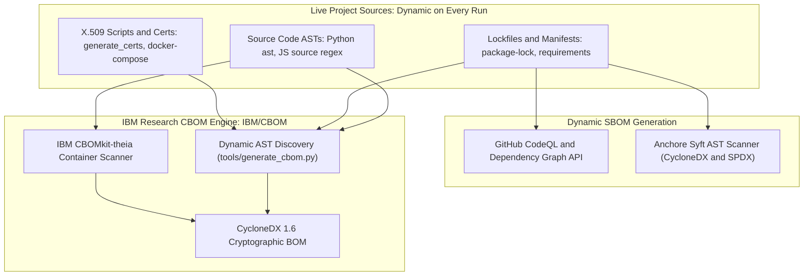

# ScatterID — Shift-Left DevSecOps Master Architecture & Learning Guide

> **Authoritative Security Engineering Guide & Portfolio Showcase**  
> **Standard:** OWASP ASVS v4.0, NIST SP 800-208, NSA CNSA 2.0, CycloneDX v1.6 (Cryptographic Extensions), Executive Order 14028  
> **Upstream Reference:** [IBM Research CBOM](https://github.com/IBM/CBOM.git), GitHub CodeQL Engine, Chainguard Distroless Images  
> **Methodology:** Shift-Left DevSecOps, Zero-Hardcoding Dynamic Discovery & Defense-in-Depth

---

## 1. Executive Overview & The Shift-Left Philosophy

### 1.1 What is "Shift-Left"?
In traditional software development, security testing (penetration testing, compliance auditing, vulnerability scanning) occurs at the very end of the lifecycle—often days before scheduled production deployment. This "Shift-Right" waterfall paradigm creates critical bottlenecks:
- Remediation is exponentially expensive ($100 to fix in code vs. $10,000+ to fix post-breach in production).
- Architectural flaws (such as insecure randomness or lack of cryptographic agility) require complete rewrites.
- Developers receive feedback weeks after writing code, disconnecting cause from effect.

**Shift-Left** moves security testing to the earliest possible point in the software development lifecycle (SDLC):



In ScatterID, security is enforced **as code** across every layer:
1. **Workstation**: Pre-commit hooks (`.pre-commit-config.yaml`) block secrets, malformed Dockerfiles, and bad patterns before `git commit`.
2. **PR Gate**: Fast-fail CI blocks merge if unit tests fail or high-severity vulnerabilities appear.
3. **Continuous Integration**: Deep semantic code analysis (CodeQL, Semgrep), dynamic SBOM & IBM CBOM extraction, and brutal mutation/tamper tests execute automatically.
4. **Ephemeral Staging**: Microservices boot in hardened containers and are dynamically attacked by OWASP ZAP (DAST).
5. **Zero Hardcoding Invariant**: All SBOM and CBOM artifacts are dynamically discovered from source ASTs, lockfiles, and certificates on every run.

---

## 2. The 8 Pillars of the ScatterID DevSecOps Pipeline

| Pillar | Category | Primary Tools | Standard / Spec | Purpose & Invariant Enforced |
| :--- | :--- | :--- | :--- | :--- |
| **1** | **Secret Scanning** | Gitleaks, `.gitleaks.toml` | Shift-Left Secrets Hygiene | Prevents hardcoded API tokens, recovery peppers, and Vault credentials from entering Git history. |
| **2** | **Static Code Analysis (SAST)** | Semgrep OSS, Bandit | OWASP Top 10, CWE Top 25 | AST pattern matching against SQL injection, insecure PRNGs (`Math.random()`), and timing attacks. |
| **3** | **Deep Semantic Analysis** | GitHub CodeQL | GitHub Advanced Security | Inter-procedural data-flow and taint-tracking across JavaScript/TypeScript and Python codebases. |
| **4** | **Container & Hardening** | Chainguard Distroless, Hadolint | CIS Docker Benchmark | Strips compilers, shells, and package managers; enforces non-root execution (`uid 65532`). |
| **5** | **Software Composition (SCA)** | Trivy, npm audit, pip-audit | National Vulnerability Database (NVD) | Continuously inventories dependencies and flags known CVEs before production deployment. |
| **6** | **Software Bill of Materials (SBOM)** | CodeQL API, Anchore Syft | SPDX 2.3 & CycloneDX 1.5/1.6 | Dynamic export of software components and dependency graphs with ZERO hardcoded data. |
| **7** | **Cryptography Bill of Materials (CBOM)** | [IBM CBOM](https://github.com/IBM/CBOM.git), `tools/generate_cbom.py` | CycloneDX 1.6 Cryptographic BOM | Dynamic AST and certificate discovery of Post-Quantum algorithms (ML-DSA-65), key sizes, and NIST levels. |
| **8** | **Dynamic Security Testing (DAST)** | OWASP ZAP (Zed Attack Proxy) | OWASP Web Security Testing Guide | Black-box dynamic fuzzing and vulnerability scanning against running HTTP microservices. |

---

## 3. Deep-Dive: Pillar by Pillar

### Pillar 1: Secret Scanning (Gitleaks)
- **What it does:** Scans staged files, uncommitted changes, and the entire Git commit graph for high-entropy strings, private keys, and API tokens.
- **Why Gitleaks?** Gitleaks is an ultrafast Go-based open-source tool that combines regex matching with Shannon entropy analysis.
- **ScatterID Configuration (`.gitleaks.toml`):**
  - Custom rules for ScatterID service keys (`scatterid-service-api-key`, `scatterid-recovery-pepper`, `scatterid-vault-approle-secret`).
  - Container prefix-tolerant regex (`(^|.*/)`) ensuring path matching works identically inside Docker containers (`/path/...`) and native workstations.
  - Zero-false-positive allowlist excluding synthetic test fixtures (`tests/**/*.test.js`, mock UUIDs).

### Pillar 2: Static Application Security Testing (SAST - Semgrep & Bandit)
- **What is AST analysis?** Unlike naive grep searches that look for strings, AST (Abstract Syntax Tree) parsers understand the syntax and grammar of the code. They can distinguish between a variable name, a string literal, and an executable function call.
- **Semgrep OSS (`.semgrep.yml`):**
  - *CWE-338 (Insecure PRNG):* Flags any usage of `Math.random()` or Python's `random` in production code. ScatterID strictly enforces `crypto.randomBytes()` and `crypto.getRandomValues()`.
  - *CWE-89 (SQL Injection):* Bans string interpolation or concatenation in SQLite query builders, requiring parameterized queries (`db.prepare('... WHERE id = ?').get(id)`).
  - *CWE-208 (Timing Attacks):* Enforces `crypto.timingSafeEqual()` when verifying secrets or HMAC hashes.
- **Bandit (Python AST Security):**
  - Scans `components/crypto/crypto-service` and CLI tools for Python-specific risks (`subprocess` shell injection, insecure deserialization via `pickle`, hardcoded binding to `0.0.0.0`).

### Pillar 3: Semantic Data-Flow Analysis (CodeQL)
- **What is CodeQL?** CodeQL treats source code as data. It compiles code into a relational database and executes queries that trace untrusted user input ("sources") across function calls, variables, and transformations to sensitive destinations ("sinks").
- Configured in `.github/workflows/devsecops.yml` across a matrix of `javascript-typescript` and `python` using `security-extended` and `security-and-quality` suites.

---

## 4. Container Hardening: Chainguard Distroless vs. Multi-Stage Stripping

Container security is fundamentally about **attack surface reduction**. Standard base images (`ubuntu`, `debian`) contain package managers (`apt`), shells (`/bin/sh`, `/bin/bash`), core utilities (`curl`, `wget`, `nc`), and C compilers (`gcc`, `make`). If an attacker achieves Remote Code Execution (RCE), these binaries become tools for privilege escalation and lateral movement.

### 4.1 Chainguard Distroless Images (`cgr.dev/chainguard/...`)
Chainguard images are purpose-built minimal container images designed specifically for production security:
- **Zero CVEs**: Built daily from audited Wolfi packages.
- **Distroless**: Contains ONLY the application runtime (`node`, `python`) and its direct shared libraries. No shell (`/bin/sh`), no package manager (`apk`/`apt`), no compilers.
- **Non-Root by Default**: Automatically runs under dedicated unprivileged users (e.g., `uid 65532` / `node`).

**Where ScatterID Uses Chainguard Distroless:**
- `components/client-portal/server/Dockerfile`:
  Uses a multi-stage pattern:
  1. **Builder Stage**: `cgr.dev/chainguard/node:latest-dev` builds TypeScript into `dist/` and installs dependencies.
  2. **Runtime Stage**: `cgr.dev/chainguard/node:latest` copies only production `node_modules` and compiled JS, executing with non-root UID 65532.

```dockerfile
# Multi-stage Chainguard Distroless build for ScatterID Client Portal Server
FROM cgr.dev/chainguard/node:latest-dev AS builder
USER root
WORKDIR /app
COPY --chown=node:node package*.json tsconfig.json ./
USER node
RUN npm ci
COPY --chown=node:node src ./src
RUN npm run build && npm prune --omit=dev

FROM cgr.dev/chainguard/node:latest
WORKDIR /app
COPY --from=builder /app/node_modules ./node_modules
COPY --from=builder /app/dist ./dist
COPY package.json ./
USER 65532
EXPOSE 5000
CMD ["dist/server.js"]
```

### 4.2 Multi-Stage Stripping for Native C++ Addons (`better-sqlite3`, `argon2`)
When microservices require native C++ addons (`better-sqlite3`, `argon2`), they must be compiled against a specific Node.js V8 Application Binary Interface (ABI).
- `cgr.dev/chainguard/node:latest` runs Node v26.12 (V8 ABI v147), where upstream V8 changes breaking changes that older native C++ bindings cannot compile against.
- **Hardened Architecture Solution**: In `components/verification-api` and `components/ops-dashboard`, we implement **multi-stage build toolchain stripping**:
  1. **Builder Stage**: Uses `node:20-slim` with build dependencies (`python3`, `make`, `g++`) to compile native C++ addons via `node-gyp`.
  2. **Production Stage**: Copies *only* the compiled native artifacts into a clean runtime image, creates a least-privilege non-root user (`nodeapp` / `appuser`), and explicitly ensures no compiler tools, package cache, or root privileges remain in production.

---

## 5. Dynamic SBOM & IBM CBOM: Zero-Hardcoding Architecture



### 5.1 Dynamic Software Bill of Materials (SBOM)
An **SBOM** provides an exhaustive, machine-readable inventory of software components, dependencies, and license metadata per **Executive Order 14028**:
1. **GitHub CodeQL / Dependency Graph API**:
   Dynamically queries GitHub's semantic graph engine:
   ```bash
   gh api -H "Accept: application/vnd.github+json" /repos/{owner}/{repo}/dependency-graph/sbom > sbom.spdx.github.json
   ```
2. **Anchore Syft**:
   Dynamically scans the filesystem and container layers to emit standard CycloneDX 1.6 and SPDX 2.3 JSON manifests.

### 5.2 Dynamic Cryptography Bill of Materials (CBOM) & IBM Standard
Upstream Specification: **[IBM/CBOM](https://github.com/IBM/CBOM.git)** (developed by IBM Research and standardized in CycloneDX 1.6).

While an SBOM catalogs *software libraries*, a **CBOM** answers:
> *"What cryptographic algorithms, key lengths, curves, protocols, and certificates protect your data—and which ones will be broken by a quantum computer?"*

**Zero-Hardcoding Guarantee in `tools/generate_cbom.py`:**
1. **Python AST Parsing**: Uses Python's native `ast` module to inspect `components/crypto/crypto-service/pq_sign.py`, dynamically detecting algorithms (`ML-DSA-44`, `ML-DSA-65`, `ML-DSA-87`) and mapping them to NIST FIPS 204 Quantum Security Levels.
2. **Manifest Discovery**: Recursively traverses all `package.json` and `requirements.txt` files to discover cryptographic libraries (`argon2`, `js-sha3`, `canonicalize`, `liboqs-python`).
3. **Source Code Call Scans**: Scans JavaScript and TypeScript source files for cryptographic primitives (`aes-256-gcm`, `createHmac('sha256')`).
4. **Certificate & Protocol Discovery**: Dynamically parses `components/crypto/certs/generate_certs.sh` for X.509 RSA CA parameters and `docker-compose.yml` for TLS 1.3 protocol configurations.
5. **IBM CBOMkit Theia Integration**: Interfaces with IBM Research's official `ghcr.io/cbomkit/cbomkit-theia:latest` container scanner.
6. **Automated Verification**: Every CBOM run is formally validated against CycloneDX 1.6 schema rules via `tests/test_cbom_compliance.py` (5/5 compliance assertions).

---

## 6. Dynamic Application Security Testing (DAST - OWASP ZAP)

DAST evaluates the application while it is actively executing. Unlike SAST, which inspects source code, DAST sends HTTP attacks to live endpoints to detect runtime vulnerabilities:
- Validates strict HTTP response headers (`Content-Security-Policy`, `Strict-Transport-Security`, `X-Frame-Options`, `X-Content-Type-Options`).
- Verifies authentication enforcement on protected endpoints (`/status/:id`, `/credentials`, `/audit`).
- Tests rate limiting and ensures no stack traces or server internals leak on error.

In ScatterID's CI/CD pipeline:
1. Docker Compose boots the microservices stack on ephemeral isolated networks (`scatterid_net`).
2. Health check probes wait until `/healthz` returns HTTP 200.
3. OWASP ZAP attacks `http://localhost:3000` (Verification API) and `http://localhost:8080` (Ops Dashboard).
4. Generates structured SARIF and HTML vulnerability reports uploaded to GitHub Security.

---

## 7. The Brutal Testing Battery ("Test Brutally From Top to Bottom")

ScatterID utilizes a 6-tier verification pyramid executing across **17 offline unit test suites**:

```
                  ┌──────────────────────┐
                  │ Chaos & Resilience   │  Vault timeouts, Slowloris, TCP reset
               ┌──┴──────────────────────┴──┐
               │ Authorization Mutation     │  14 mutants injected into chaincode & API
            ┌──┴────────────────────────────┴──┐
            │ Tamper Sensitivity Verification  │  26,472 bit flips exhaustively rejected
         ┌──┴──────────────────────────────────┴──┐
         │ Generative Fuzzing & Parity (5k iters) │  RFC 8785 canonicalization cross-engine
      ┌──┴────────────────────────────────────────┴──┐
      │ Boundary & NIST CAVP Math Verification       │  Salt boundaries, off-by-one, RFC tests
   ┌──┴──────────────────────────────────────────────┴──┐
   │ Comprehensive Unit & Functional Suites (17 Suites) │  SDK, Verification API, Ops Dashboard, etc.
   └────────────────────────────────────────────────────┘
```

### Highlights of the Brutal Suite:
- **Tamper Sensitivity (`tests/test_tamper_sensitivity.py`):**
  Exhaustively flips every single bit in a 32-byte SHA3-256 hash (256 tests) and all 26,472 bits in a NIST ML-DSA-65 post-quantum signature. **Invariant: 100% of bit flips must be rejected.**
- **Authorization Mutation (`tests/mutation_auth.test.sh`):**
  Injects 14 distinct code mutations (inverting MSP checks, bypassing signature verifications, inverting status transitions). If tests continue to pass on mutated code, the mutant survived and the test fails. **Invariant: 100% of mutants killed.**
- **RFC 8785 Parity Fuzzer (`tests/fuzz_canonicalize_parity.py`):**
  Generates 5,000 randomized JSON documents containing Unicode surrogate pairs, exponential floats, nested arrays, and whitespace to verify that Python and Node.js produce identical byte outputs.

---

## 8. Developer Quick-Start & Local DevSecOps Runner

Execute the complete Shift-Left DevSecOps battery on your local workstation with a single command:

```bash
# Run the complete DevSecOps audit battery (Secrets, SAST, SBOM, CBOM, SCA, Tests)
bash scripts/security/devsecops_audit.sh
```

### Install Pre-Commit Hooks
```bash
pip install pre-commit
pre-commit install
pre-commit run --all-files
```

### Run Dynamic CBOM Generation & Compliance
```bash
python3 tools/generate_cbom.py cbom.cyclonedx.json
python3 -m unittest tests/test_cbom_compliance.py
```

---

## 9. Portfolio Showcase & Interview Guide

When presenting this project to interviewers or security leads, highlight these differentiators:

1. **Shift-Left by Design, Not as an Afterthought:**
   Explain how pre-commit hooks and PR gates stop vulnerabilities before code merges, eliminating emergency hotfixes.
2. **First-Class Post-Quantum Cryptography (PQC) & CBOM:**
   ScatterID implements NIST FIPS 204 ML-DSA-65 signatures and automatically generates an [IBM/CBOM](https://github.com/IBM/CBOM.git) compliant CycloneDX 1.6 Cryptographic BOM directly from code ASTs.
3. **Zero Hardcoding Invariant:**
   All SBOMs and CBOMs are dynamically computed from lockfiles, ASTs, and certificate parameters on every run.
4. **Hardened Container Strategy (Chainguard Distroless):**
   Demonstrate deep architectural understanding of attack surface minimization: pure JS/TS services running on Chainguard distroless (UID 65532, zero CVEs, no shell), and native C++ services utilizing multi-stage toolchain stripping to remove GCC and make from production.
5. **Mutation and Tamper Invariants:**
   Explain how mutation testing proves the *quality* of tests by demonstrating that security bypasses are caught with a 100% kill rate.
